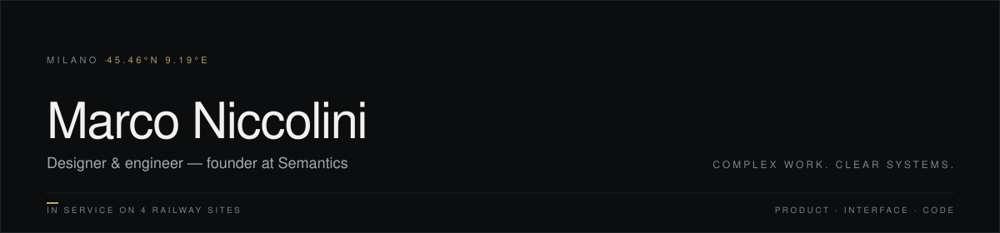

I build software for work that cannot stop: railway operations, field crews, venues where a spreadsheet quietly turns into risk. Product, interface and code as one continuous line — I design the thing, then I build it.

Founder at **[Semantics](https://marconiccolini.com/#semantics)**. Before that: software engineer at Capgemini Engineering, then two years independent. The thread through all of it — making operational truth visible before it becomes a problem on site.

### Selected work

**[Quantara](https://marconiccolini.com/work/quantara/)** — operations control for railway projects  
`2026` `Founder & Product Engineer` `TypeScript · PostgreSQL` `In service`  
One shared record of progress, cost, documents and decisions per site — every edit keeps its author, so a review starts from the data instead of from memory.

**[Halion](https://marconiccolini.com/work/halion/)** — treasury intelligence for on-chain teams  
`2026` `Full-stack` `Next.js · TypeScript` `Private`  
Wallet and stablecoin flows turned into one operating view. Wallet-native sign-in, read-only by design, no custody at any point.

**[Scandellari](https://marconiccolini.com/work/scandellari/)** — website for a railway contractor  
`2025` `Full-stack` `React · Node.js · Express` [Live](https://scandellarigiacintosnc.it/)  
Fifty years of work history given a credible first impression online. The field study that became Quantara.

**[Bombyx](https://marconiccolini.com/work/bombyx/)** — digital menu for a cocktail bar  
`2024` `Lead Developer` `React · TypeScript` [Live](https://bombyx-menu.vercel.app/) · [Source](https://github.com/Nicco6598/bombyx-menu)  
Menu changes go live the moment the bartender decides. Built for sticky hands, weak signal and a hundred tables at once.

### How I work

- **One line, not three handoffs.** Product decision, interface and implementation are the same conversation.
- **The data model earns the interface.** If the record is honest, the screen can be simple.
- **Ship to the field.** Weak signal, gloves, deadlines — software only counts where the work happens.

### Elsewhere

- Site — [marconiccolini.com](https://marconiccolini.com)
- LinkedIn — [in/marconiccolini](https://www.linkedin.com/in/marconiccolini-/)
- Email — [nicco6598@gmail.com](mailto:nicco6598@gmail.com)

Most of what I build now is private or lives in client infrastructure — these repositories are the public edge of it. The earlier experiments are still open: **[sillage](https://github.com/Nicco6598/sillage)** (AI-assisted scent diary), **[Exora](https://github.com/Nicco6598/Exora)** (prediction markets), **[MooveMP](https://github.com/Nicco6598/MooveMP)** (NFT marketplace on Sepolia).
